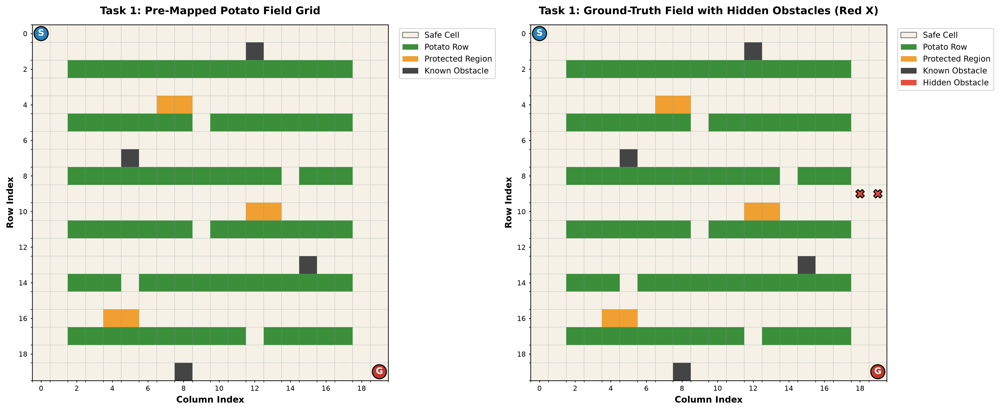
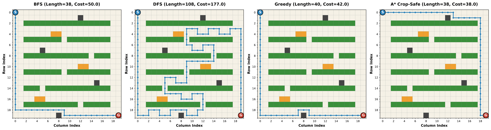
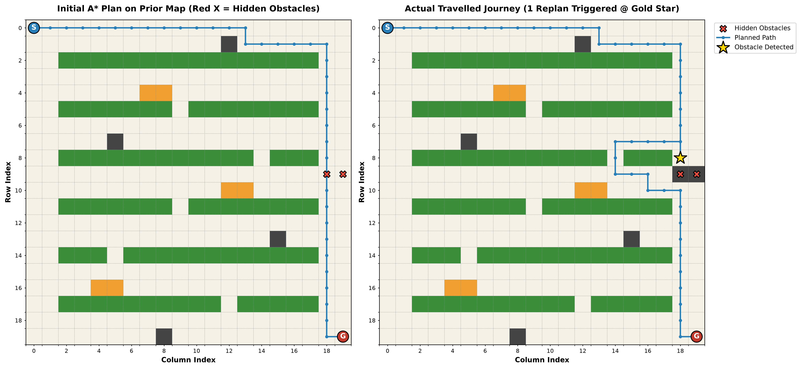
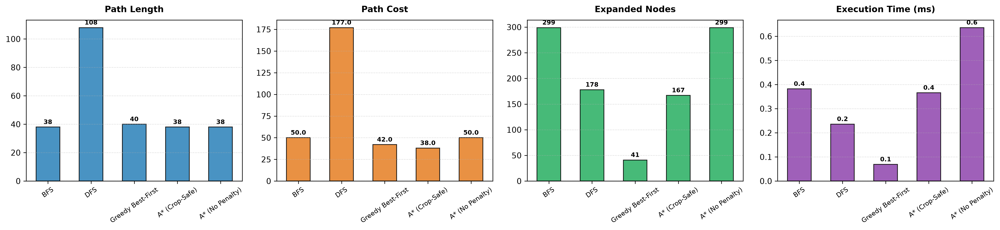

# AI-Based Crop-Safe Path Planning for an Autonomous Potato-Field Robot

[](https://www.python.org/)
[](https://jupyter.org/)
[](LICENSE)
[](https://doi.org/10.1016/j.compag.2026.112016)

---

## 1. Executive Summary & Project Background

In precision agriculture, autonomous ground mobile robots (UGVs) are increasingly deployed for automated crop monitoring, targeted weed control, disease phenotyping, and soil assessment ([Wei et al., 2026](https://doi.org/10.1016/j.compag.2026.112016)). However, navigating agricultural fields introduces domain-specific challenges that conventional open-space path planners fail to address:

1. **Crop Row Topology:** Potatoes are cultivated along raised parallel ridges. Ground robots must travel between rows in dedicated aisles and utilize service transfer gaps or field headlands to switch rows without running over crop beds.
2. **Crop-Protection Sensitivities:** Delicate seedling beds and protected breeding plots require buffer clearance. Even if adjacent pathways are physically traversable, passing immediately beside protected vegetation risks root disturbance, soil compaction, and foliage entanglement.
3. **Dynamic / Unmapped Obstacles:** Field conditions are unstructured and dynamic. Irrigation fixtures, fallen branches, stones, and farm machinery are frequently absent from pre-mission aerial maps, requiring real-time sensing and online replanning.

In this project, **we formulate, implement, benchmark, and evaluate** a complete artificial intelligence path-planning system for an autonomous robot navigating a simulated $20 \times 20$ potato field. We implement and compare four classical search algorithms—**Breadth-First Search (BFS)**, **Depth-First Search (DFS)**, **Greedy Best-First Search**, and **A\* Search**—incorporate a **Chebyshev proximity penalty model** for crop preservation, and demonstrate **real-time obstacle detection with online reactive A\* replanning**.

---

## 2. Field Environment Architecture (Task 1)

We represent the potato field as a discrete two-dimensional grid of size $20 \times 20$ ($R = 20, C = 20$), yielding 400 discrete spatial cells:

* **Safe Travelling Cells (`SAFE = 0`, Cream `#f5f1e6`):** Open headlands (columns $0-1$ and $18-19$) and inter-row pathways where the robot can freely maneuver at unit step cost.
* **Potato Rows (`POTATO = 1`, Green `#3b8f3b`):** Crop ridges running along rows 2, 5, 8, 11, 14, and 17 (from column 2 to 17). Permeable service gaps are placed at $(5, 9)$, $(8, 14)$, $(11, 9)$, $(14, 5)$, and $(17, 12)$ to enable inter-row transitions.
* **Crop-Protection Regions (`PROTECTED = 2`, Orange `#f0a030`):** High-priority seedling beds located at $(4, 7)$, $(4, 8)$, $(10, 12)$, $(10, 13)$, $(16, 4)$, and $(16, 5)$. Physical intrusion into these cells is strictly prohibited.
* **Known Pre-Mapped Obstacles (`OBSTACLE = 3`, Dark Slate `#444444`):** Fixed obstacles (e.g., stones, monitoring poles) located at $(1, 12)$, $(7, 5)$, $(13, 15)$, and $(19, 8)$.
* **Hidden / Dynamic Obstacles (Red 'X'):** Located along the eastern headland corridor at $(9, 18)$ and $(9, 19)$, initially omitted from the robot's pre-mission map to evaluate online reactive replanning.

The robot's deployment base is **Start $(0, 0)$** (top-left) and the target monitoring station is **Destination $(19, 19)$** (bottom-right).



---

## 3. Formal Search Problem Formulation (Task 2)

We formulate the autonomous path-planning mission as a discrete state-space search problem $\mathcal{P} = \langle \mathcal{S}, s_0, \mathcal{A}, \mathcal{T}, \mathcal{G}, c \rangle$:

1. **State Space ($\mathcal{S}$):** Grid coordinates $s = (r, c)$ such that $0 \le r < 20$ and $0 \le c < 20$.
2. **Initial State ($s_0$):** $s_0 = (0, 0)$.
3. **Action Space ($\mathcal{A}(s)$):** Four cardinal movements:
   $$\mathcal{A} = \{\text{'U'}: (-1, 0), \; \text{'D'}: (+1, 0), \; \text{'L'}: (0, -1), \; \text{'R'}: (0, +1)\}$$
   An action $a$ is valid from state $s$ if and only if the destination cell $s'$ is within grid bounds and is not occupied:
   $$\text{Grid}[s'] \notin \{\text{POTATO}, \text{PROTECTED}, \text{OBSTACLE}\}$$
4. **Transition Model ($\mathcal{T}(s, a)$):** Deterministic transition $s' = (r + \Delta r, c + \Delta c)$.
5. **Goal Test ($\mathcal{G}(s)$):**
   $$\mathcal{G}(s) \iff s == (19, 19)$$
6. **Path-Cost Function ($c(s, a, s')$):**
   $$c(s, a, s') = 1.0 + \text{Penalty}(s')$$

---

## 4. Crop-Safe Planning: Proximity Penalty Model (Task 4)

To protect delicate potato seedlings without completely closing adjacent aisles, we formulate a spatial proximity cost using the **Chebyshev distance metric** ($L_\infty$). For any traversable cell $(r, c)$, its distance to the nearest protected seedling cell $(r_p, c_p) \in \mathcal{C}_{\text{prot}}$ is:

$$d_\infty(r, c) = \min_{(r_p, c_p) \in \mathcal{C}_{\text{prot}}} \max(|r - r_p|, |c - c_p|)$$

We define the proximity penalty field as:

$$\text{Penalty}(r, c) = \begin{cases} 
5.0, & \text{if } d_\infty(r, c) = 1 \quad (\text{immediately adjacent cell}) \\
2.0, & \text{if } d_\infty(r, c) = 2 \quad (\text{buffer / near cell}) \\
0.0, & \text{if } d_\infty(r, c) > 2 \quad (\text{crop-safe zone})
\end{cases}$$

This structure heavily discourages trajectories that skirt seedling beds, guiding cost-minimizing algorithms to select safer alternative aisles.

---

## 5. Search Algorithms & Heuristic Design (Task 3)

We implement four search algorithms:

* **Breadth-First Search (BFS):** FIFO queue; systematically finds paths with minimal step count ($38$ steps), but ignores proximity penalties ($\text{Cost} = 50.0$).
* **Depth-First Search (DFS):** LIFO stack; explores deep into ridge alleys, producing a highly suboptimal wandering path ($108$ steps, $\text{Cost} = 177.0$).
* **Greedy Best-First Search:** Priority queue driven purely by $f(n) = h(n)$; expands very few nodes ($41$), but achieves suboptimal cost ($\text{Cost} = 42.0$).
* **A\* Search:** Evaluates $f(n) = g(n) + h(n)$ with path cost tracking and Manhattan heuristic; finds the **globally optimal crop-safe trajectory** ($\text{Cost} = 38.0$, with zero penalty).

### Heuristic Design: Manhattan Distance
For 4-connected grid movement, we define the heuristic as:
$$h(s) = |r - r_{\text{goal}}| + |c - c_{\text{goal}}|$$

* **Admissibility Proof:** Any orthogonal path between $(r, c)$ and $(r_g, c_g)$ requires at least $|r - r_g| + |c - c_g|$ steps. Since each step costs $c \ge 1.0$, $h(s) \le h^*(s)$.
* **Consistency Proof:** For adjacent cells $s, s'$, $h(s) - h(s') \le 1.0 \le c(s, a, s')$, ensuring non-decreasing $f$-values and optimal graph search without node re-expansions.



---

## 6. Dynamic Obstacle Sensing & Online Replanning (Task 5)

We simulate an onboard proximity sensor with perception radius $R_{\text{sensor}} = 1$ (Chebyshev neighborhood). As the robot moves along its pre-planned route:
1. It senses adjacent cells prior to each movement.
2. When the robot reaches position $(8, 18)$, it detects the hidden obstacles at $(9, 18)$ and $(9, 19)$.
3. The robot halts, updates its internal map (`known_map[r, c] = OBSTACLE`), and recalculates an A\* trajectory from its current position to $(19, 19)$.
4. The robot smoothly detours through the adjacent aisle and reaches the goal.



---

## 7. Performance Benchmarks & Empirical Evaluation (Task 6)

### Table 1: Static Map Performance Benchmark ($N = 100$ runs)
| Algorithm | Reached | Path Length | Path Cost | Expanded Nodes | Execution Time (ms) |
|:---|:---:|---:|---:|---:|---:|
| **BFS** | True | 38 | 50.0 | 299 | 0.382 ms |
| **DFS** | True | 108 | 177.0 | 178 | 0.236 ms |
| **Greedy Best-First** | True | 40 | 42.0 | 41 | 0.069 ms |
| **A\* (Crop-Safe)** | **True** | **38** | **38.0** | **167** | **0.366 ms** |
| **A\* (No Penalty)** | True | 38 | 50.0 | 299 | 0.636 ms |

### Table 2: Online Replanning Benchmark with Hidden Obstacles ($N = 20$ runs)
| Planner | Reached | Journey Length | Journey Cost | Replanning Ops | Total Expanded | Execution Time (ms) |
|:---|:---:|---:|---:|---:|---:|---:|
| **BFS** | True | 38 | 50.0 | 0 | 299 | 1.380 ms |
| **DFS** | True | 208 | 328.0 | 1 | 379 | 2.681 ms |
| **Greedy Best-First** | True | 40 | 42.0 | 0 | 41 | 1.079 ms |
| **A\* (Crop-Safe)** | **True** | **48** | **57.0** | **1** | **239** | **2.514 ms** |



---

## 8. Key Observations & Algorithmic Insights

1. **Impact of Crop-Safe Penalties:** When penalties are disabled (`A* No Penalty`), the planner selects an identical length route ($38$ steps) that skirts seedling beds, incurring a true cost of $50.0$. With penalties enabled, A\* reroutes through central aisles, achieving the minimal cost of $38.0$ with **zero crop penalty**.
2. **Informed vs. Uninformed Search:** BFS expands nearly the entire free space ($299$ nodes) because it lacks directional guidance. A\* with Manhattan heuristic focuses the search cone directly toward the destination, expanding $44\%$ fewer nodes ($167$ nodes).
3. **Greedy Heuristic Trade-off:** Greedy Best-First Search is the fastest algorithm ($0.069$ ms, $41$ nodes), making it suitable for low-power microcontrollers, but it sacrifices cost optimality ($42.0$ vs $38.0$).
4. **Online Replanning Efficacy:** A\* seamlessly handles unmapped obstacles with minimal overhead ($1$ replan operation, $2.51$ ms), successfully discovering detour paths in real time.

---

## 9. Repository Structure

```
AI_CropSafe_PathPlanning/
├── AI_CropSafe_PathPlanning.ipynb   # Master executed notebook (all tasks, code & plots)
├── README.md                        # Academic-grade project documentation
├── results_static.csv               # Exported static benchmark metrics
├── results_online.csv               # Exported online replanning benchmark metrics
├── field_environment.png            # Visual display of the 20x20 potato field
├── static_paths_comparison.png      # Route comparison across BFS, DFS, Greedy & A*
├── online_replanning_demo.png       # Before/after visual demonstration of dynamic replanning
├── performance_comparison.png       # Publication-ready comparative performance charts
└── .gitignore                       # Git ignore file for Python/Jupyter artifacts
```

---

## 10. How to Run the Project

### Prerequisites
* Python 3.10+
* Required packages: `numpy`, `pandas`, `matplotlib`, `jupyter` / `ipykernel`

### Installation & Execution
```bash
# Clone the repository
git clone https://github.com/anmol1140w/AI_CropSafe_PathPlanning.git
cd AI_CropSafe_PathPlanning

# Create and activate virtual environment
python3 -m venv .venv
source .venv/bin/activate

# Install dependencies
pip install numpy pandas matplotlib ipykernel

# Launch Jupyter Notebook
jupyter notebook AI_CropSafe_PathPlanning.ipynb
```

All cells can be executed sequentially via `Cell -> Run All`.

---

## 11. Academic References

1. **Wei, Y., Johnson, J., Bagavathiannan, M., & Lee, K.** (2026). *A multirobot system for autonomous crop field scouting: System integration and demonstration*. Computers and Electronics in Agriculture, 251, 112016.
2. **Russell, S., & Norvig, P.** (2020). *Artificial Intelligence: A Modern Approach* (4th ed.). Pearson.
3. **Hart, P. E., Nilsson, N. J., & Raphael, B.** (1968). *A formal basis for the heuristic determination of minimum cost paths*. IEEE Transactions on Systems Science and Cybernetics, 4(2), 100–107.
4. **Stentz, A.** (1995). *The focussed D\* algorithm for real-time replanning*. International Joint Conference on Artificial Intelligence (IJCAI), 1652–1659.
